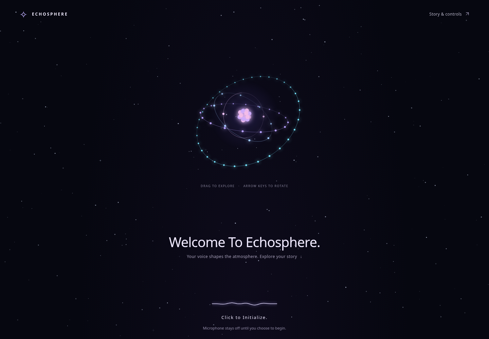

# EchoSphere

A voice-reactive universe: a twinkling starfield, an interactive 3D atom, local acoustic analysis, continuous stereo ambience, and live Evolus narration. Accessible text input and a labelled offline scripted scene are included.

[Deploy on Render](https://render.com/deploy?repo=https://github.com/sg01-stack/project-zero) · [Deployment guide](docs/DEPLOYMENT.md) · [Judge walkthrough](docs/SUBMISSION.md) · [Project handoff](HANDOFF.md)



Drag the atom to explore its four orbit planes and 60 electrons, or focus it and use the arrow keys; **Home** resets the view. **Click to Initialize.** requests microphone access. After a quiet 1.2-second calibration, your voice changes the orbit speed, radius, glow, and centered waveform. **Story & controls** opens the narrative workspace below. The interface adapts to mobile screens and respects reduced-motion preferences. All visuals are rendered locally without external fonts, images, or 3D libraries.

**For judges:** use the deployed HTTPS link. No Studio installation, Node.js installation, or judge-owned API key is needed online. The submitter configures the hosting secret once. The repository includes deployment configuration; a live URL still requires the owner's Render account setup.

**Without API access:** choose **Try offline scene**. It is explicitly scripted, not an LLM. Typed actions, audio classification, synthetic signal tours, and local stereo ambience remain available.

EchoSphere captures continuous audio, classifies vocal delivery, and sends completed-turn JSON to the existing Evolus agent backed by the user’s AMD-hosted model. A live browser-to-agent response has been verified. **It is a heuristic prototype, not a trained whisper/speech/noise classifier.** No detector based only on amplitude, zero crossings, and pitch can perfectly distinguish whispers, breathing, wind, coughing, and speech on arbitrary microphones.

## Run on Windows / Microsoft Edge

1. Download the latest repository ZIP and **extract the entire folder**.
2. Install [Node.js LTS](https://nodejs.org/) (version 22 or newer) if it is not already installed. The app has no npm dependencies to install.
3. Double-click **Start EchoSphere.cmd**. Keep its terminal window open. It starts the local backend and opens the app in your default browser; paste the printed address into Edge if desired.
4. In **Your narrative agent**, enter your Evolus key in the local setup form and click **Connect and test agent**. The configured agent ID is already filled in. A real response appears when the test succeeds. Choose **Remember on this computer** to keep the key across restarts.
5. Click **Click to Initialize.** on the welcome screen and allow microphone access. Stay quiet for 1.2 seconds, then speak or whisper and pause for a response. The atom responds immediately; **Story & controls** contains replies, device selection, and the input meter.

**A cloud-environment secret is not part of a GitHub ZIP.** Enter your key locally once; do not put it in source code or send it in chat. Remembered settings live in `.echosphere.local.json`, excluded from Git and inaccessible through the web server. This is a local plain-text settings file (owner-only permissions where supported), not an encrypted credential vault. With Remember unchecked, the key stays only in the running backend and any previously saved settings file is removed. Existing environment variables or `.env` settings take precedence on restart.

Double-clicking `index.html` supports the detector and offline scripted scene; it cannot start the backend or connect Evolus. It now shows the launcher instructions prominently and uses compatibility capture to avoid local-file worklet loading failures. **Use the launcher for the complete microphone → JSON → agent → response workflow.** Browser/device policies can still restrict microphone access to local files.

## Run from a terminal / develop

```sh
git clone https://github.com/sg01-stack/project-zero.git
cd project-zero
npm start
```

`npm start` starts the local backend and opens the browser. `npm run start:headless` starts the same backend without opening a browser. In local mode, the server binds only to this computer and chooses a free port if port 8000 is occupied. Hosted mode binds the platform port and uses the configured HTTPS origin; see the deployment guide. Use the address it prints, on the same machine as your microphone. Node 24.5+ also supports the cloud environment's network proxy automatically. You can alternatively copy `.env.example` to `.env` and set the key there; the browser never receives environment secrets.

```sh
npm test
npm run build
npm run test:browser
```

The complete source page is `index.html`, its stylesheet is `style.css`, and browser modules are in `src/`. `src/visuals.mjs` renders the starfield, perspective-projected atom, and waveform; `src/experience.mjs` contains the explicitly scripted offline scene, synthetic tours, and stereo ambience. `npm run build` generates the committed `dist/app.js` and single-file `dist/echosphere.html`. Rebuild after editing browser source. Build tools and the app use Node's built-in libraries; the optional browser tests need Playwright and Chromium.

## If audio does not start

- **Microphone permission granted, but startup fails:** open **Microphone diagnostics**. It now identifies the failed step and preserves the browser's error, instead of labelling every `AbortError` as a microphone-device problem.
- **Worklet module rejected or unavailable:** capture switches automatically to compatibility mode, keeping contiguous 50 ms frames. Compatibility processing runs on the main thread and can lag under heavy browser load. Direct-file pages use this mode without attempting a worklet import.
- **Audio device aborts:** startup retries once with default audio-processing settings. If that also fails, choose a different input, close other apps using the microphone, and check Windows microphone privacy settings.
- **Permission request stuck:** click **Cancel microphone request**. Late permission grants are cleaned up, and audio-context/worklet startup has time limits.
- **Calibration fails:** click **Recalibrate** and remain silent. Use the input meter to check that the selected device receives audio. Calibration input containing speech or strong bursts is deliberately rejected.
- **Agent unavailable:** locally, launch the full app and enter your key in its setup form; online, the owner configures the host secret. Use **Test agent connection**. That makes a real API request independent of microphone capture and reports its result.

The microphone never plays through your speakers. **Play response** uses an installed local voice and stops microphone capture before playback to prevent feedback. Stop/Start recalibrates and begins a new story session.

## What was wrong

- The old `volume > 55 || (volume > 25 && zeroCrossings > 75)` condition made loud speech and unvoiced consonants/whispers become transients. Zero crossings indicate frequency/noisiness, not a transient's duration or meaning.
- “Transient” changed immediately; recovering a speech label took several frames. Display flicker was built into that asymmetry.
- A 512-sample analyzer polled every 30 ms observed only roughly 11 ms at 48 kHz, with gaps and timer-dependent timing.
- The baseline learned loud speech, not just background noise. Low-amplitude voiced speech was treated as whispering.
- `dominantMood` was the latest label rather than a duration-based summary; it was not reset with the other turn statistics.
- Recognition results were discarded. Browser `SpeechRecognition` is not reliably local and may miss whispers or return late.
- The JSON was displayed but never submitted. Hardcoded synthesized replies were not LLM responses and could feed back into the microphone.

## Revised behavior

The AudioWorklet, or its compatibility fallback, captures **contiguous 50 ms PCM frames**. RMS, peak, crest factor, normalized periodicity, estimated pitch, and spectral bands feed a temporal state machine. Main-thread analysis and UI delivery can still be delayed under browser load; 50 ms framing is not a hard real-time guarantee.

| Output | Meaning |
| --- | --- |
| `voiced_speech` | Sustained periodic signal consistent with voiced speech; quiet speech stays voiced. Music and machinery can also be periodic. |
| `whisper_like` | Sustained unvoiced, speech-band energy with temporal modulation. Tentative: a breath or changing background noise can resemble it. |
| `transient` | Short isolated unvoiced burst, with sharp attack/crest and observed rapid decay. A high RMS or high zero-crossing count alone cannot trigger it. |
| `uncertain_audio` | Insufficient speech/whisper evidence. Report separately instead of assigning an emotion. |

An onset is buffered for 200 ms. An isolated burst needs 150 ms of following quiet before it is reported. Whisper-like evidence requires at least 350 ms and stabilization. Established voiced speech holds through unvoiced consonants for up to 700 ms; a sustained switch to whisper can therefore take about one second. This trades instant labels for fewer false changes. Short voiced utterances below 200 ms are conservatively reported as uncertain short audio.

Turns finish after 800 ms below the calibrated gate. Long turns split at 30 seconds (`continues: true`), so frame storage stays bounded. Manual stop flushes an active turn. Silence does not dilute active-audio energy. Style duration, RMS energy, pitch evidence, clipping, uncertainty, and transcripts are summarized independently; loudness does not imply anger, urgency, or mood.

Brief impulses inside an established utterance are absorbed by the turn's continuity rather than switching the whole turn to “transient.” Long coughs or blowing may remain uncertain or resemble speech; this is not a cough recognizer. Continuous noise that rises after calibration may prevent an early endpoint; recalibrate if the environment changes. Noise cancellation/automatic gain control are requested off where supported, but browser/device settings may override those requests.

## JSON and integration

`echosphere:frame` is emitted every analyzed 50 ms frame for ambient sound/haptic control. **Do not invoke an LLM 20 times per second.** `echosphere:audio-event` reports bursts/uncertain audio separately. `echosphere:turn` contains a completed turn, ready for an agent:

```json
{
  "schema_version": "1.0",
  "event": "user_turn_complete",
  "session_id": "session-uuid",
  "turn_id": "session-uuid:1",
  "timing": {
    "start_ms": 1200,
    "end_ms": 3200,
    "duration_ms": 2000,
    "active_audio_ms": 2000,
    "end_reason": "silence",
    "continues": false
  },
  "transcript": null,
  "speech_evidence": {
    "source": "acoustic_heuristics",
    "words_available": false,
    "speech_confirmed_by_asr": false,
    "certainty": "low"
  },
  "prosody_analysis": {
    "dominant_style": "whisper_like",
    "style_duration_ms": { "voiced_speech": 0, "whisper_like": 1600, "uncertain_audio": 400 },
    "average_rms_dbfs": -34.2,
    "peak_dbfs": -20.5,
    "signal_above_noise_db": 25.8,
    "voiced_fraction": 0,
    "median_pitch_hz": null
  },
  "quality": {
    "noise_floor_dbfs": -60,
    "clipped": false,
    "possible_non_speech": true,
    "emotion_inferred": false
  },
  "llm_guidance": "Use prosody as tentative delivery context; do not invent words or infer emotion."
}
```

Values above are illustrative. Scores/labels are not calibrated confidence probabilities. dBFS is digital amplitude relative to full scale, **not calibrated sound pressure** and not a device-independent “intensity percent.” There is intentionally no `dominant_mood` field. Typed actions use `event: "user_text"`, a `transcript` marked `source: "typed"`, and `prosody_analysis: null`; they never fabricate acoustic measurements.

### Live Evolus agent integration

The confirmed route is:

```text
GET  https://api.evolus.ai/v1/models
POST https://api.evolus.ai/v1/chat/completions
Authorization: Bearer <server-side key>
```

Evolus uses `applicationId:agentId` in the chat API’s `model` field. The authenticated model list returned:

```text
8f6b7471-0aaf-43f0-ad70-474e17559724:405d18ba-6acf-43cd-9d76-7eddb9710603
```

The agent is `405d18ba-6acf-43cd-9d76-7eddb9710603`. Its underlying model is configured in Evolus as `own/gemma-4-31b-it`, but using that model name directly in this API returned HTTP 400 with “Expected: {applicationId}:{agentId}.” The full route returned a real narrative response. No extra undocumented agent endpoint is needed.

The backend lists the key’s accessible routes and selects the one matching `EVOLUS_AGENT_ID` (which defaults to this project’s agent). An old `EVOLUS_MODEL=own/gemma-4-31b-it` value is harmless: it is ignored as a routing preference when the accessible agent has a unique match. If several applications expose the same agent, a complete returned `applicationId:agentId` in `EVOLUS_MODEL` resolves the ambiguity. An unrelated agent is never selected just because it is first in the list.

The browser automatically connects after the backend confirms the agent route. The backend sends the complete turn JSON as a user message, with separate guidance about uncertain acoustic cues, and returns the actual agent reply. Recent successful turns are included as context: up to six exchanges per session, across at most 32 sessions. A microphone restart creates a fresh session. Conversation history and delivery caches are in memory and disappear when the server restarts.

The saved Evolus agent’s behavior still applies. During live checks it returned Italian narration, including when the adapter requested English. Set the desired language in the agent’s own instructions if needed; the adapter cannot guarantee that its extra system message overrides the agent configuration. It also cannot independently audit the AMD deployment behind Evolus.

The server exposes browser assets plus `/api/health`, `/api/status`, `/api/config`, `/api/check`, and `/api/turn`. The local setup and connection-test routes require a per-process setup token and same-origin requests. Hosted mode disables credential changes, isolates visitor sessions using secure cookies, and caps real API calls. The browser uses the same origin for assets and API requests. Status distinguishes a verified agent route from an actual successful completion in the current process. Requests are same-origin, size-limited, validated, and timed out. The backend never returns credentials. Keys entered into the setup form are sent to the local backend, cleared from the input, and never saved in browser storage. Completed and concurrent retries of a turn ID reuse a cached response; a reused ID with different content is rejected. Failed calls remain retryable, and turns in one session are ordered. The cache retains 256 successful turns; production use needs durable idempotency and persistence.

Browser delivery retains failures for the Retry button. Queues disappear on reload, and capture stops at 100 undelivered turns. `Download latest JSON` saves only the currently displayed event. No hardcoded mock reply is shown in normal operation.

### Custom integration

`echosphere:frame` supplies continuous telemetry, `echosphere:audio-event` carries uncertain/transient events, `echosphere:turn` supplies completed turns, and `echosphere:response` carries the real agent reply. A different backend can register `window.echoSphere.setTurnHandler(async payload => { ... })`. Resolve only after acceptance and throw on failure. This replaces the built-in delivery handler.

A separate local JSON receiver can use `window.echoSphere.connectLocalEndpoint({url: YOUR_LOCAL_ENDPOINT})`. The helper permits only loopback HTTP(S), refuses redirects, and expects a successful HTTP status. The included server accepts same-origin requests; a separate receiver must configure its own CORS policy.

### Local ASR

This patch does not contain a speech-recognition model and does not invent a transcript. Feed cumulative recognition results from your local ASR while the turn is active:

```js
const { turnId } = window.echoSphere.getStatus();
window.echoSphere.addTranscript({
  turnId,
  text: 'Stay quiet, someone is outside.',
  isFinal: true,
  source: 'your_local_asr',
});
```

Store the turn ID when submitting audio to ASR and return **that same ID**, not whichever ID is current when the result arrives. Interim results replace earlier text rather than being concatenated repeatedly. Late results after the turn has closed return `false`; your backend must buffer/join them by ID if ASR runs slower than the 800 ms endpoint. No words means `transcript: null`, and the agent should only use tentative delivery context. For stronger real-world separation, use a speech VAD/model validated on whispers plus representative recordings from the actual microphone. A general VAD is not automatically good at whispering.

## Validation and scope

- `npm test`: 42 passing automated tests cover signal regression cases, 16/44.1/48 kHz features, calibration, clipping, turn summaries, transcript ownership, worklet/compatibility capture framing, delivery retry/timeouts, the HTTP backend, local setup, settings persistence, agent resolution, deduplication, and conversation isolation.
- `npm run build`: builds `dist/app.js` and the self-contained `dist/echosphere.html` from source. Do not edit generated files by hand.
- `npm run test:browser`: Playwright/Chromium checks the root and standalone pages with a fake microphone and external module requests blocked. It covers microphone-to-JSON delivery with worklet failure forced to `AbortError`, compatibility fallback, permission/device errors, cancellation and late permission cleanup, interrupted-device retries, hung audio startup, local key setup, agent routing with a mock provider, visible replies, mobile layout, and local-voice playback wiring with a mock voice. Direct file navigation is also checked where browser policy permits it; a policy block is explicitly reported as skipped. It never uses live credentials.
- `npm run test:submission`: verifies mouse/keyboard atom rotation, voice-driven visual energy, the first mobile screen, offline typed storytelling, all three synthetic tours, ambient controls, and an HTTPS proxy simulation with secure visitor cookies and no judge key entry. The provider is mocked in this check.
- `npm run test:live`: an explicit, optional live test. It requires the server key, Playwright, and Chromium, and makes one real agent completion. Set `ECHOSPHERE_CAPTURE_MODE=compatibility` to verify the fallback path against the live agent. The verified path is fake microphone → AudioWorklet → detector → local HTTP backend → live Evolus agent → browser. It stops capture after the first turn to avoid repeated paid requests. Ordinary tests do not call the live API.

Browser checks require Playwright to be available to Node and Chromium at `/usr/bin/chromium` (or `CHROMIUM_PATH`). They were available in the cloud workspace and are not app runtime dependencies. The optional `.env` supports local execution; no real key is included in the project or archive.

An additional check used the public 11-second [jfk.flac fixture from OpenAI Whisper](https://github.com/openai/whisper/blob/main/tests/jfk.flac). It produced one predominantly voiced turn, no transient events, and no whisper classifications. It is not bundled and is not a whisper benchmark.

This delivers the detector/JSON/agent-response workflow from the supplied prototype. It includes a basic continuously modulated stereo soundscape and optional browser vibration preview. It does not implement local ASR, binaural multi-character synthesis, or directional haptic hardware. Frame events are available for those components. Acoustic analysis is local; Evolus inference is remote, so this deployment is not fully offline.

These checks are not a measured accuracy rate on real whispers/coughs or your microphone. Test quiet/loud speech, whispered sentences, sustained “s”/“f” sounds, short words, coughing, blowing, snaps, room noise, and playback on the actual device. No hardware microphone or audible speaker output was tested in the cloud. Ambiguous sounds remain explicitly uncertain instead of being labeled as emotion.
