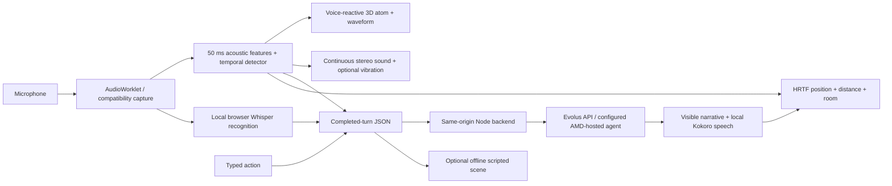

# EchoSphere — submission notes

## Pitch

EchoSphere turns vocal delivery into a continuous narrative control signal. In a twinkling starfield, a draggable 3D atom with eight orbits and 122 electrons reacts as the participant speaks. Local 50 ms audio analysis stabilizes speech/whisper-like/transient decisions and updates both the orbits and a stereo soundscape. Completed-turn JSON controls narration through an Evolus agent backed by the submitter's AMD-hosted model. Typed input provides an accessible alternative. An explicitly labelled offline scripted scene lets people explore without API access.

## What judges can try in two minutes

1. Open the deployed HTTPS link. Drag the atom to rotate it, or use the arrow keys. Click **Story & controls** to check **Live · Evolus agent** or choose **Offline · scripted scene**.
2. Click **Click to Initialize.** and allow microphone access. On first use, wait for browser speech-model downloads (roughly 200 MB+), then stay quiet for calibration. Warm this browser before a timed presentation. Speak and see the orbits and waveform react.
3. Enable ambient stereo audio with headphones. Vocal delivery changes scene intensity, filtering, and stereo position. Vibration preview is available only on supported browsers/devices.
4. Say “I take the left passage and listen.” Verify the recognized words and automatic spoken response. Speak during narration to interrupt it. Audition another voice or choose a distant placement in Voice & space.
5. Inspect the JSON payload. With microphone access denied, use the clearly labelled synthetic signal tour instead; it does not call the LLM.

Offline responses are scripted and always labelled. They are never presented as proof that the live agent works.

## Architecture

## Demonstrated scope

- Local PCM processing; raw microphone audio is not sent to Evolus.
- A locally rendered starfield, draggable eight-orbit 3D atom, and continuous voice-reactive visual feedback, with keyboard and reduced-motion support.
- Temporal speech/whisper-like/transient heuristics with explicit uncertainty.
- Continuous stereo ambience and optional browser vibration preview.
- Actual JSON delivery, provider responses, retry protection, and per-visitor conversation isolation in hosted mode.
- Text input, local voice playback, keyboard controls, clear permission failures, and compatibility capture.
- Dependency-free Node runtime, Windows launcher, Render configuration, Dockerfile, and automated checks.

## Honest limitations

This is a hackathon prototype. It includes browser Whisper/Kokoro integration and a single HRTF-positioned narrator, but not learned emotion inference, multi-character direction, calibrated directional haptic hardware, or a measured whisper-classification accuracy benchmark. Ambient stereo panning is separate from the narrator's HRTF rendering. Browser vibration is not directional haptics. The live narrative model is remote. The first speech-model download is substantial and local inference speed depends on the visitor's device. Tests use synthetic audio and browser automation; physical microphone, headphone localization, and voice quality require listening tests.

Before submission, finish the outstanding acceptance checks: successful real Whisper recognition and Kokoro generation, followed by the complete flow on the actual deployed HTTPS URL. Current cloud model access is blocked by network policy; the conversation test uses mocked models. Do not claim this is already a verified public demo.

The saved Evolus agent initially returned Italian despite system-role English guidance. Placing the English narration request directly before the intact JSON report produced an English live response; the adapter now uses that format. Still verify the saved agent's language on the deployed service if its configuration changes.

## Submission fields

- Repository: https://github.com/sg01-stack/project-zero
- Live demo: add the actual Render HTTPS URL after deployment and verification; do not submit a placeholder.
- Setup and deployment: [DEPLOYMENT.md](DEPLOYMENT.md)
- Continuation context: [HANDOFF.md](../HANDOFF.md)
