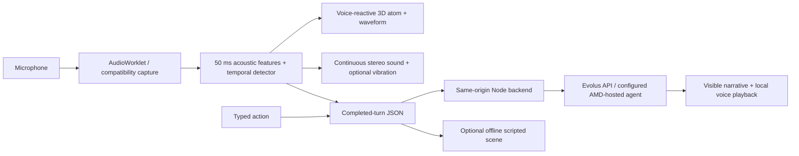

# EchoSphere — submission notes

## Pitch

EchoSphere turns vocal delivery into a continuous narrative control signal. In a twinkling starfield, a draggable 3D atom with four shells and 60 electrons reacts as the participant speaks. Local 50 ms audio analysis stabilizes speech/whisper-like/transient decisions and updates both the orbits and a stereo soundscape. Completed-turn JSON controls narration through an Evolus agent backed by the submitter's AMD-hosted model. Typed input provides an accessible alternative. An explicitly labelled offline scripted scene lets people explore without API access.

## What judges can try in two minutes

1. Open the deployed HTTPS link. Drag the atom to rotate it, or use the arrow keys. Click **Story & controls** to check **Live · Evolus agent** or choose **Offline · scripted scene**.
2. Click **Click to Initialize.**, allow microphone access, and stay quiet for calibration. Speak normally and see the orbits and waveform react. Whisper a sentence, then make a short snap; the workspace shows acoustic style and separate transient events.
3. Enable ambient stereo audio with headphones. Vocal delivery changes scene intensity, filtering, and stereo position. Vibration preview is available only on supported browsers/devices.
4. Pause for a live response, or type “I take the left passage and listen.” Use Play response for an installed local voice.
5. Inspect the JSON payload. With microphone access denied, use the clearly labelled synthetic signal tour instead; it does not call the LLM.

Offline responses are scripted and always labelled. They are never presented as proof that the live agent works.

## Architecture

## Demonstrated scope

- Local PCM processing; raw microphone audio is not sent to Evolus.
- A locally rendered starfield, draggable four-shell 3D atom, and continuous voice-reactive visual feedback, with keyboard and reduced-motion support.
- Temporal speech/whisper-like/transient heuristics with explicit uncertainty.
- Continuous stereo ambience and optional browser vibration preview.
- Actual JSON delivery, provider responses, retry protection, and per-visitor conversation isolation in hosted mode.
- Text input, local voice playback, keyboard controls, clear permission failures, and compatibility capture.
- Dependency-free Node runtime, Windows launcher, Render configuration, Dockerfile, and automated checks.

## Honest limitations

This is a hackathon prototype. It does not include local automatic speech recognition, learned emotion inference, multi-character binaural speech synthesis, calibrated directional haptic hardware, or a measured whisper-classification accuracy benchmark. Stereo panning is not full binaural 3D rendering. Browser vibration is not directional haptics. The live model is remote, so the live experience is not fully offline. Tests use synthetic audio and browser automation; actual microphone and speaker behavior still depends on the judge's hardware.

The existing Evolus agent returned Italian narration during verification despite English adapter guidance. Change its language instructions in Evolus before an English-only presentation. Do not claim the adapter can override the agent's saved instructions reliably.

## Submission fields

- Repository: https://github.com/sg01-stack/project-zero
- Live demo: add the actual Render HTTPS URL after deployment and verification; do not submit a placeholder.
- Setup and deployment: [DEPLOYMENT.md](DEPLOYMENT.md)
- Continuation context: [HANDOFF.md](../HANDOFF.md)
