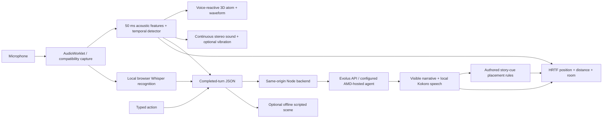

# EchoSphere — submission notes

## Track and requirements

**Selected track: Track 4, Create a New Kind of Experience.** Source: the participant-supplied transcript of the [AMD Developer Hackathon Act 3 kickoff](https://www.youtube.com/live/gqUj24Gtdr0), also supplied as a [Twitch recording](https://www.twitch.tv/videos/2898871287). The videos themselves could not be retrieved in this cloud environment; this interpretation is based on the pasted transcript.

| Requirement in the kickoff | EchoSphere implementation / evidence |
| --- | --- |
| Meaningful workload on AMD infrastructure | Narrative inference through the Evolus agent connected to the participant's AMD-hosted open model. Record actual GPU/deployment evidence before submission. Browser audio processing is separate. |
| Two different audiences, situations, or inputs | Quiet discovery versus distant encounter, available as two labelled typed inputs and repeatable live spoken scenarios. Preserve both replies and show the audio/placement difference. |
| Explain authored versus generated work | Authored detector, graphics, story-placement rules and offline script; model-generated recognition, narrative text, and neural speech. |
| Explain quality and consistency | Recent session history, constrained short English narration, visible recognized text, acoustic uncertainty, bounded spatial controls, interruption and one idle prompt per interaction. These are controls, not guarantees of correct transcription or perfect story consistency. |
| Explain costs and who pays | Cost worksheet and customer proposal below. Use actual dashboard charges, not invented per-request pricing. |
| Description, presentation of at most five minutes, public GitHub and accessible demo | Description below; [presentation outline](PRESENTATION.md); repository/run instructions; [owner deployment walkthrough](START-HERE.md). A verified public URL is still outstanding. |

The separate **Evolus Business Agents** challenge additionally requires a real business process and at least two Evolus platform building blocks. EchoSphere currently uses **one agent**; [see the explanation](EVOLUS-BUILDING-BLOCKS.md). Do not claim that the browser models, AMD endpoint, or this web page are a second Evolus building block.

**Why Render is used:** the supplied kickoff requires a meaningful workload on AMD, not every web asset on AMD. Render hosts the page and Node proxy; narrative inference remains on the configured AMD deployment. This arrangement fits that wording, subject to the organizers' final decision and evidence that the AMD workload is actually running.

## Pitch

EchoSphere is an audio-first interactive storytelling prototype for entertainment creators and museum-style experiences. In a starfield, a draggable 3D atom with sixteen orbits and 222 electrons reacts as the participant speaks. Local 50 ms acoustic analysis shapes visuals and ambience; browser Whisper recognizes words. An Evolus agent connected to the submitter's AMD-hosted open model leads the story and responds to the participant. Local Kokoro narration moves through binaural space according to story cues and vocal delivery. Participants can interrupt, speak softly, or use text. An explicitly labelled offline script provides a fallback. Live narrative inference is remote; the whole system is not fully local.

## What judges can try in two minutes

1. Open the deployed HTTPS link. Drag the atom to rotate it, or use the arrow keys. Click **Story & controls** to check **Live · Evolus agent** or choose **Offline · scripted scene**.
2. Click **Click to Initialize.** and allow microphone access. On first use, wait for browser speech-model downloads (several hundred MB with the default model), then stay quiet for calibration. Warm this browser before a timed presentation. The guide opens the story. Speak and see the orbits and gently moving waveform react.
3. Enable ambient stereo audio with headphones. Vocal delivery changes scene intensity, filtering, and stereo position. Vibration preview is available only on supported browsers/devices.
4. Whisper “Please stay beside me and speak softly while we listen at the door.” Then say clearly “Is someone there? Let a distant voice answer from the right.” Verify the recognized words and compare the responses and automatic voice placement. Speak during narration to interrupt it. If a microphone is unavailable, use the two labelled written inputs under **One world. Two different inputs.** They do not fabricate acoustic measurements.
5. Inspect the JSON payload. With microphone access denied, use the clearly labelled synthetic signal tour instead; it does not call the LLM.

Offline responses are scripted and always labelled. They are never presented as proof that the live agent works.

## Architecture

## Demonstrated scope

- Local PCM processing; raw microphone audio is not sent to Evolus.
- A locally rendered starfield, draggable sixteen-orbit 3D atom, and continuous voice-reactive visual feedback, with keyboard and reduced-motion support.
- Temporal speech/whisper-like/transient heuristics with explicit uncertainty.
- Continuous stereo ambience and optional browser vibration preview.
- Actual JSON delivery, provider responses, retry protection, and per-visitor conversation isolation in hosted mode.
- Text input, local voice playback, keyboard controls, clear permission failures, and compatibility capture.
- Dependency-free Node runtime, Windows launcher, Render configuration, Dockerfile, and automated checks.
- Guide-led opening, cancellable streaming responses, speculative recognition that never sends unfinished words, and automatic placement from narrated context.

## Meaningful AMD workload: collect evidence

The user identified the agent's underlying model as `own/gemma-4-31b-it` on AMD Developer Cloud. The verified API routes to the configured Evolus agent; an API reply alone does not independently prove its underlying GPU hardware.

Before submission, record the actual AMD instance's GPU name, the open model/revision, serving stack (for example the vLLM deployment actually used), and a timestamped demonstration of an EchoSphere request reaching that server. Use the AMD dashboard and model server's normal request logs. Hide credentials and private endpoint tokens. Include the Evolus model-connection view showing this deployment. Do not invent a GPU, ROCm version, throughput result or server command that was not used.

Keep that instance running and confirm the workspace expiry during judging. The Node web host does not replace it.

## Customer and value proposal

Potential paying customers are immersive-experience studios, museums, and independent interactive-audio creators. They could author one story world and offer visitors different, interruptible experiences without pre-recording every branch. A venue/creator subscription with a usage allowance is a proposed business model, not validated revenue. Useful pilot measurements would be completion rate, creator editing time, participant-reported immersion, transcription corrections, and response latency compared with a fixed narrated scene. No improvement percentage is claimed without a study.

## Cost per experience: use the real bill

Choose one measurement period and record:

| Quantity | Where to obtain it |
| --- | --- |
| AMD GPU instance hours and hourly price | AMD Developer Cloud usage/billing; include idle provisioned time. |
| Node host cost over the same period | Render plan/usage dashboard. The configured free tier can sleep. |
| Billable Evolus platform usage | Evolus usage dashboard; do not assume all platform features share one price. |
| Number of completed demo sessions | Count completed sessions during that measurement period without storing raw audio. |
| First model-download size and recognition/speech latency | Browser network/performance observations on the test device. |

`Average infrastructure cost per completed experience = (AMD GPU cost + app hosting cost + billable Evolus services during the period) / completed experiences during the same period.`

Browser Whisper/Kokoro incur no external per-request speech-provider charge, but use local CPU/memory and download bandwidth. The kickoff says the team's own AMD model does not consume Evolus model credits; any other platform services need their own usage accounting. Event credits/free hosting subsidize a demo and do not establish a permanent zero-cost service. Report “not yet measured” until these numbers are available.

One live streaming opening in development took **5.68 seconds to first text and 5.70 seconds total**. Most chunks arrived together. This is a single provider observation, excludes local ASR/TTS, and is not an end-to-end latency benchmark. Streaming, shorter replies, early recognition and opening prefetch reduce avoidable waiting; they cannot eliminate remote model or local-device latency.

The final live typed comparison also passed: the quiet response described a guide “right here by your side” and mapped to the close preset (0.65 m); the distant response answered “from the far right” and mapped to 7 m / 55° right. Browser-to-final-text times in that run were 4.10 s and 3.09 s. These are actual Evolus responses and local placement decisions, not measured real Whisper/Kokoro or audible headphone results. Reproduce with the optional `npm run test:judge-live` (two provider calls); generated wording can vary.

## Honest limitations

This is a hackathon prototype. It includes browser Whisper/Kokoro integration and a single HRTF-positioned narrator, but not learned emotion inference, multi-character direction, calibrated directional haptic hardware, or a measured whisper-classification accuracy benchmark. Ambient stereo panning is separate from the narrator's HRTF rendering. Browser vibration is not directional haptics. The live narrative model is remote. The first speech-model download is substantial and local inference speed depends on the visitor's device. Tests use synthetic audio and browser automation; physical microphone, headphone localization, and voice quality require listening tests.

Before submission, finish the outstanding acceptance checks: successful real Whisper recognition and Kokoro generation, followed by the complete flow on the actual deployed HTTPS URL. The cloud allowlist was published and confirmed on 2026-10-18, but the active proxy still denies Hugging Face and the real model test fails to fetch. The conversation test uses mocked models. Do not claim this is already a verified public demo.

The saved Evolus agent initially returned Italian despite system-role English guidance. Placing the English narration request directly before the intact JSON report produced an English live response; the adapter now uses that format. Still verify the saved agent's language on the deployed service if its configuration changes.

## Submission fields

- Repository: https://github.com/sg01-stack/project-zero
- Live demo: add the actual Render HTTPS URL after deployment and verification; do not submit a placeholder.
- Setup and deployment: [DEPLOYMENT.md](DEPLOYMENT.md)
- Continuation context: [HANDOFF.md](../HANDOFF.md)
